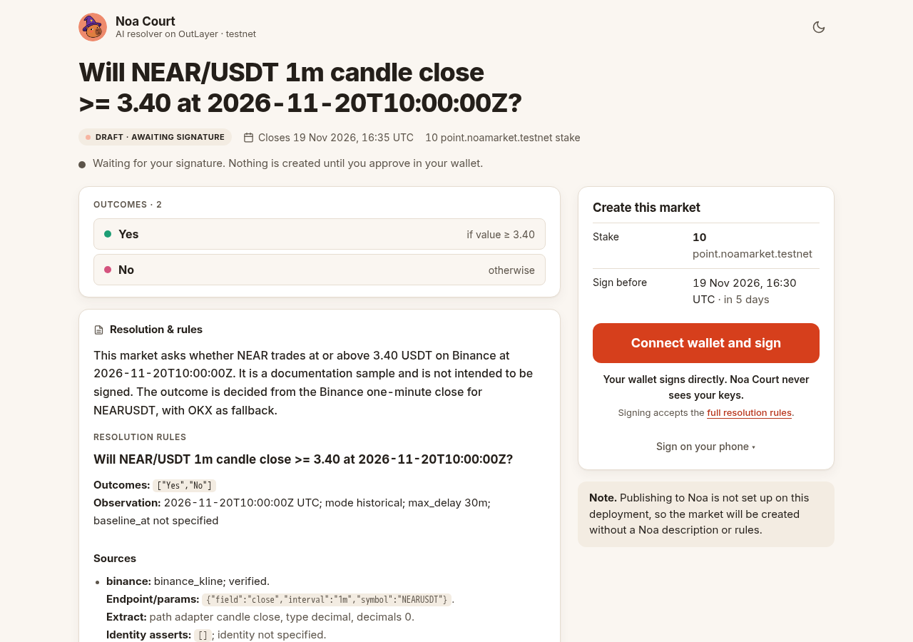
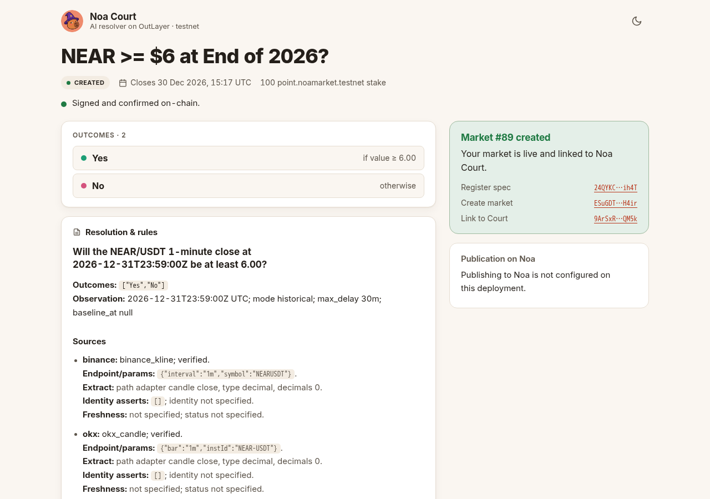

# Noa Court

**An AI resolver for prediction markets, running live on NEAR mainnet.** Resolution rules are locked as a hashed spec before trading, the sources are tested against real data, and the outcome is decided inside an [OutLayer](https://outlayer.ai) TEE. When evidence is missing or ambiguous, the market is voided and bettors are refunded.

## Live on NEAR mainnet

Live since 2026-11-14. Court `ai-resolver.noamarket.near` resolves markets on [Noa](https://noamarket.xyz) (`v3.noamarket.near`). First market resolved and finalized on mainnet: [#26](#live-markets-on-mainnet).

- **MCP endpoint:** `https://court.noamarket.xyz/mcp` (stateless Streamable HTTP, no auth, rate limited). [Health](https://court.noamarket.xyz/healthz). Sign pages live at `https://court.noamarket.xyz/sign/<id>`.
- **Docs:** [README](https://court.noamarket.xyz/docs/README.md), [MCP](https://court.noamarket.xyz/docs/MCP.md), [SPEC](https://court.noamarket.xyz/docs/SPEC.md), [ARCHITECTURE](https://court.noamarket.xyz/docs/ARCHITECTURE.md), [INTEGRATE](https://court.noamarket.xyz/docs/INTEGRATE.md), [NEAR_TOKENS](https://court.noamarket.xyz/docs/NEAR_TOKENS.md), [SKILL](https://court.noamarket.xyz/docs/SKILL.md).
- **Contract:** [`ai-resolver.noamarket.near`](https://nearblocks.io/address/ai-resolver.noamarket.near). The keeper runs next to the MCP, and `trusted_keeper` is `null`: mainnet is TEE-only, with no fallback.

Connect an agent:

```sh
# Claude Code
claude mcp add --transport http noacourt https://court.noamarket.xyz/mcp
# Codex (then set default_tools_approval_mode = "approve" under [mcp_servers.noacourt] in config.toml)
codex mcp add noacourt --url https://court.noamarket.xyz/mcp
```

- **Claude.ai:** add `https://court.noamarket.xyz/mcp` as a custom connector.
- **ChatGPT:** enable developer mode and add a connector with URL `https://court.noamarket.xyz/mcp`, without authentication.

Then prompt: "Use court_guide, sample NEAR/USDT from Binance and OKX, draft and simulate a future two-outcome Court market, then show the rules and a wallet sign link." You get a preflight verdict and a `/sign/<id>` link. The wallet signs only after you review the plan. Wallets: NEAR Connect with Intear, Meteor (extension, web and app) and HOT.

Stakes use Noa-whitelisted tokens from `list_whitelisted_tokens`; the default is `npoint.noamarket.near`. Live mainnet minimum stakes for a 2-outcome market: NPOINT 100, wNEAR 1, TEAR 600, SHITZU 3,000, MPOO 1,000,000, BLACKDRAGON 500,000,000 (checked 2026-11-14; call the tool for current values).

## Resolved in a TEE

Resolution runs in an [OutLayer](https://outlayer.ai) TEE. Court calls OutLayer on chain, accepts a verdict only from the OutLayer callback, and stores it with `tee: true` and `submitted_by: "outlayer"`. The pinned resolver is `39e5a6ce…3f6d8c` and its exact bytes are on [FastFS](https://main.fastfs.io/court-ops.noamarket.near/outlayer.near/39e5a6ceb7160e1b8eda6f294ff249d00dfe7d250f088848fb64ea1f0c3f6d8c.wasm). Consumers that need TEE execution should check `tee == true` on the receipt.

## How it works

1. **Draft and lock.** An agent drafts a canonical JSON spec, samples the sources, lints and simulates it. The creator signs `Court.register_spec` and `Noa.create_market` from the sign page.
2. **Resolve.** At observation time the keeper triggers the pinned WASM resolver in the OutLayer TEE. It fetches the sources, extracts the value and decides by deterministic code. Text questions go to three NEAR AI Cloud jurors who must all agree.
3. **Record.** The Court contract checks the verdict, keeps the receipt and resolves the Noa market. If evidence is missing, changed or ambiguous, the market is voided and bettors are refunded.

The keeper links, triggers, retries, voids and finalizes automatically, and cannot choose outcomes. Detail: [How it works (diagram)](#architecture) and [architecture](docs/ARCHITECTURE.md).

## Screenshots

| Pending request | Created market |
| --- | --- |
|  |  |

Both screenshots come from the testnet instance. The pending request is a sample created only for this screenshot; nobody signed it. The created request is testnet market 89, signed by the owner with publication disabled.

## What is in the service

- **Metadata publication to Noa (enabled on mainnet).** `market_create_link` takes an optional `description`. The sign page freezes it with the rendered rules, renderer version, spec hash and a metadata digest. The creator signs a NEP-413 Noa login before the create transactions, the browser publishes description and rules to Noa (write-once; Noa production CORS allows `court.noamarket.xyz`), and the server reads them back to verify (rate-limited). A retry panel remains after reload. Controlled by `NOA_API_URL`, `NOA_AUTH_RECIPIENT` and `NOA_MARKET_URL_BASE`; when unset it is disabled and the page says so (the testnet instance runs this way: no public Noa testnet API exists). [Testnet E2E on markets 87 and 88](e2e/publish/RESULTS-20261114.md); [task status](openspec/changes/publish-noa-market-metadata/tasks.md).
- **NEAR Connect wallets.** The sign page uses `@hot-labs/near-connect` 0.11.5 (vendored) with Intear, Meteor (extension, web and app) and HOT Wallet. HOT is mainnet-only because it has no testnet support.
- **Sign page in Noa's layout.** Outcomes with win conditions, a Resolution & rules card with a creator / resolver (TEE) / sources footer, a sticky sign panel, and a "How resolution works" section that credits OutLayer. Light and dark themes, labeled transaction links (Register spec, Create market, Link to Court).
- **Custom token and stake.** `list_whitelisted_tokens` returns active Noa-whitelisted tokens with symbol, decimals, minimum trade and minimum stake per outcome count. `market_create_link` accepts any of them as `token_id` and a custom `stake` (the creator's liquidity), and rejects stakes below the minimum.

## Live markets on mainnet

Markets created through the MCP and resolved by Court on NEAR mainnet:

| Market | Question | Outcome | Evidence |
| --- | --- | --- | --- |
| [#26](https://noamarket.xyz/markets/26-will-the-near-usdt-1-minute-close-at-2026-11-14t19-28-00z-be) | Will the NEAR/USDT 1-minute close at 2026-11-14T19:28:00Z be at least 3.10? | **No** (Binance close 3.092 < 3.10; OKX 3.093) | Finalized. `tee: true`, `submitted_by: "outlayer"`, attempt 1, OutLayer request 3646 |

Market #26 step by step (all on [NearBlocks](https://nearblocks.io/address/ai-resolver.noamarket.near)):

1. An agent drafted, sampled and simulated the spec through the MCP, then called `market_create_link` with a plain-English description. The creator signed the served plan: [register spec](https://nearblocks.io/txns/747HJbU87o2y3awCvZga3U1N6EphEWdzXEjq4jSG3kUG), [create market](https://nearblocks.io/txns/4HTi4ygMDWoBCMtGST9cB8CqYj1RJfiDYHak1R8KQQ7n), [link to Court](https://nearblocks.io/txns/G6JtTSAmnkLbotHfoYHf31QKp9cck9sxJjbDsSXcQC13). Stake: 100 NPOINT.
2. The reviewed description and rules were published to Noa with the creator's NEP-413 login and verified by read-back.
3. Two traders bet 50 NPOINT each: [Yes](https://nearblocks.io/txns/9JDirAV774giJBFQZSpAttfmjZQWNyvqXFk8fxa74P8Y), [No](https://nearblocks.io/txns/MLtb4H5VbkHJTm161Jqs5gQitgf9EHfHcYcGSy6jhj1).
4. At 19:28 UTC + 70 s the keeper [triggered](https://nearblocks.io/txns/8A3AQWuJEaNmH8fsXWjyJBw1kRLCbZK2pkqF4bTfSZDu) Court. OutLayer ran the pinned resolver `39e5a6ce…` in a TEE, which fetched Binance (3.092, used) and OKX (3.093, fallback). Court accepted the verdict `No` with `tee: true` at 19:29:33 UTC and proposed it to Noa.
5. After Noa's 60-minute dispute window the keeper [finalized](https://nearblocks.io/txns/AG7B9991kRwMDLJ45fhnScohDaASzniuB7KwNVhtHxGd) the market. The No bettor [claimed](https://nearblocks.io/txns/9SkEudErvURUWcEiZepYkAti9U9xwCs8usBTJyaRAopA) 86.56 NPOINT. Full run log: [run-mainnet-20261114T185017Z.md](e2e/mcp-agent/run-mainnet-20261114T185017Z.md).

## Status and limits

- Mainnet has one finalized market so far (#26 above). The broader scenario evidence (price, RSS text judge, void, generic requests) is from testnet and listed below.
- A real-wallet browser run of the publication path is not yet recorded (only a Node stub wallet ran it, on testnet markets 87 and 88).
- The mobile wallet matrix is untested, as is metadata backfill of markets created earlier.
- Noa clears `image_url` and `embed_url` on the first publish when they are omitted (`apps/indexer/src/api/api.ts:991-1009` in the closed-source noamarket monorepo, so not checkable from this repository).

## Try it

1. Open [service health](https://court.noamarket.xyz/healthz) → see the MCP service status and that the served, published and Court-pinned resolver hashes match.
2. Connect an agent as shown [above](#live-on-near-mainnet) and ask it to draft and simulate a market → see a preflight verdict and a `/sign/<id>` URL.
3. Open the sign link in a browser → see the review-first sign page: rules generated from the spec, sources with their `verified` / `self_declared` labels, the OutLayer TEE resolver, and the exact transactions (`Court.register_spec`, `Noa.create_market`). Connect a wallet through NEAR Connect to sign. After creation the page asks for a NEP-413 signature and publishes the reviewed description and rules to the Noa market page.
4. Read [E2E results](E2E_RESULTS.md) → inspect scenario outcomes, transaction hashes, and independent checks (testnet). [Market 86](e2e/mcp-agent/run-20261113T093809Z.md) was created end to end by a Codex CLI agent that used only the public testnet MCP server: 11 MCP calls and no shell commands.
5. Follow [integration steps](docs/INTEGRATE.md) → request a generic verdict or create a Noa market.

For agents, read the [Noa Court skill](skills/noa-court/SKILL.md) ([hosted copy](https://court.noamarket.xyz/docs/SKILL.md)). For NEAR token price, market cap and FDV questions, follow the [Intear and JustHoot recipes](docs/NEAR_TOKENS.md) ([hosted copy](https://court.noamarket.xyz/docs/NEAR_TOKENS.md)); one source is the default, with a two-source median offered only as an optional choice.

## Verified on testnet

These receipts come from the testnet instance (`ai-resolver.noamarket.testnet`), where the full pipeline was exercised before the mainnet launch. Live market ID: <!-- E2E:A1_ID -->67<!-- /E2E:A1_ID -->. A1 price-market receipt: <!-- E2E:A1 -->[market 67](https://testnet.nearblocks.io/txns/GtfMBy2GmCKKNLjBGbNm7Wppf3VTnZ8ydB92bMrBsDWs)<!-- /E2E:A1 --> and <!-- E2E:A1_TX -->[resolution transaction](https://testnet.nearblocks.io/txns/GtfMBy2GmCKKNLjBGbNm7Wppf3VTnZ8ydB92bMrBsDWs)<!-- /E2E:A1_TX -->; A8 text-judge [market 79 resolution](https://testnet.nearblocks.io/txns/7JnWtdYRhPK5muTsUMC27Bg8nyhd8zBFNsTXhFGR28DL). Query the stored verdicts:

```sh
near contract call-function as-read-only ai-resolver.noamarket.testnet get_verdict json-args '{"id":"noa:67"}' network-config testnet now
near contract call-function as-read-only ai-resolver.noamarket.testnet get_verdict json-args '{"id":"noa:79"}' network-config testnet now
```

### Scenarios

All first-wave scenarios in [E2E_RESULTS.md](E2E_RESULTS.md) passed. Their Court verdicts have `tee: true` and `submitted_by: "outlayer"`:

All first-wave scenarios in [E2E_RESULTS.md](E2E_RESULTS.md) passed. Their Court verdicts have `tee: true` and `submitted_by: "outlayer"`:

- [A1, market 67](E2E_RESULTS.md): NEAR/USDT threshold → No. The first attempt retried because the candle had not closed; the [second trigger](https://testnet.nearblocks.io/txns/GtfMBy2GmCKKNLjBGbNm7Wppf3VTnZ8ydB92bMrBsDWs) resolved it. The [creation](https://testnet.nearblocks.io/txns/EUkohRdRE3mwvSScTe1BUqHfXKVm8CC33aVozMsLVNWF), [keeper link](https://testnet.nearblocks.io/txns/BeDq3T2vXBRx9MXZ4RnXN2gcXzgwtyDGcNWsRK1gGwoU), [first trigger](https://testnet.nearblocks.io/txns/F9Vnr7LReUPce96ANZMqZQboYkR3jJGwvqvRkbWWPN1m), [finalization](https://testnet.nearblocks.io/txns/6kWLDoBw8prE6FS8Beb4gQKSzoiwL8dbSh2W4HpNypsL), and [claim](https://testnet.nearblocks.io/txns/92W5cP3cF7uzwKVZ21QS1yJqLW3EZR2ajfdUypPugmEn) are also recorded.
- A8, market 79: a 15-minute RSS `text_judge` market with real opposing bets—user2 [bet Yes](https://testnet.nearblocks.io/txns/7tNvi2wiReAeSjpUnRemSc1pHhqCzsjmHQqwBjr9toUj), user4 [bet No](https://testnet.nearblocks.io/txns/2WKsnVpmNtyc2Rwd1sturW1HCntjTshMHEnhWRuVqaKP). Three NEAR AI jurors agreed on Yes inside the TEE; the [trigger transaction](https://testnet.nearblocks.io/txns/7JnWtdYRhPK5muTsUMC27Bg8nyhd8zBFNsTXhFGR28DL) contains the OutLayer verdict and Noa resolution (`tee: true`). The proposal was [finalized](https://testnet.nearblocks.io/txns/5YESzkVyunsctNaPLPAEypvUonT9NHxfgH8qGyLHbdiL), and the winner [claimed](https://testnet.nearblocks.io/txns/FiUEfZpBLifAVS6r9d3bTfrWWwy1EQsKaniCENHFAkHN).
- [A2, market 68](E2E_RESULTS.md): BTC price buckets → Flat.
- [A3, market 69](E2E_RESULTS.md): BTC price change → Up.
- [A4, market 70](E2E_RESULTS.md): NPOINT `ft_balance_of` through `near_view` → Yes.
- A6, market 76: a changed JSON identity failed its assertion on all three attempts (`assert_failed`); the market never resolved, became `Unresolvable`, and was [voided](https://testnet.nearblocks.io/txns/BVuv2dZF6pWSLmY5JFYsSZ11rNdzCJ7wkEfoPQiLHm1A). Bettors were refunded.
- A7, market 77: the deleted source returned `http_4xx` on all three attempts; the market became `Unresolvable` and was [voided](https://testnet.nearblocks.io/txns/3NbFB8K2giB7yxxFyfUCcunjNWd2Etfw2kvn2xzPYREW).
- A8, market 73: an in-window RSS post resolved Yes after three agreeing NEAR AI jurors inside the TEE; [trigger and resolution](https://testnet.nearblocks.io/txns/HMUwVHVvegxTKANcMiGvToiynC32BdRid28q9A1skBNt).
- A8 rerun, market 78: OutLayer execution failed twice and returned null. Court rejected the null, and the market was [voided](https://testnet.nearblocks.io/txns/9uRxS8JUQHuK9a4L9foWgYySgsHSX3nurkToArzkUgsx) without a wrong outcome. Cause: a slow juror call could outlive OutLayer's time limit. Resolver v2 added a 90-second run budget with guest-enforced HTTP timeouts. The A8 regression rerun, [market 82](E2E_RESULTS.md), then resolved Yes with 3 jurors and `tee: true`.
- A8n, market 74: no in-window post resolved No through `default_if_no_evidence`, without calling jurors; [trigger and resolution](https://testnet.nearblocks.io/txns/6vNnXRHexjnu1W699kqsLiSUnYgoDWuYiN9MFgnmTdFB).
- A9, market 75: a prompt-injection-only post resolved No after three agreeing jurors; the injection phrase was flagged; [trigger and resolution](https://testnet.nearblocks.io/txns/D4zeVBo7kT8nTmtftaqf4HdFFK8NQZorLxJXQEyjDZYw).
- [Generic request `req:1`](docs/INTEGRATE.md#verified-on-testnet): [`request_resolution` transaction](https://testnet.nearblocks.io/txns/EwTtoX8cAJBDUZWJrYnKchPdbnkQa8dnNJCuxnoXwPrZ) and [keeper trigger](https://testnet.nearblocks.io/txns/2FjTEHWCp6Um7Ro8NSgqGd4ukjz7i2qWAEsxJ1dtP9GA); final verdict Yes, value `3.401`, attempt 2, `tee: true`.

The configured resolver is pinned to WASM SHA-256 `39e5a6ceb7160e1b8eda6f294ff249d00dfe7d250f088848fb64ea1f0c3f6d8c` (resolver v3, [`resolver/WASM_SHA256`](resolver/WASM_SHA256)); `bash scripts/build-resolver.sh` reproduces it. Markets 67–79 ran on the earlier pin `a8efb56c2f9fe31c2d857686d8b97179b15d8529a17984bfd31fc3f97ef6ce40`. Each receipt records the version it ran. [Service health](https://court.noamarket.xyz/healthz) shows that the served, published and Court-pinned hashes match. A6–A9 fixtures are served by the MCP host at `https://noacourtmcp.junstudio.xyz/fixtures/<name>` and labelled `self_declared`; that host is outside the verified-source list.

## Architecture

```text
Agent + creator wallet
  │ draft → sample → lint → simulate → /sign/<id>
  ▼
MCP server ── creator signs ──► Court.register_spec ──► Noa.create_market
  │                                  │                         │
  └── permissionless keeper ───────► Court.link_market ◄──────┘
                                     │ trigger after observation.at
                                     ▼
                             outlayer.near (testnet: outlayer.testnet)
                             configured resolver.wasm
                             fetch → extract → decide
                                     │ Verdict v1 callback
                                     ▼
                              Court receipt ──► Noa resolution
                                     └─────────► generic callback / get_verdict
```

The verifiable fetch, extract, and decide path runs in an OutLayer TEE for normal resolution. Drafting, source sampling, lint, simulation, wallet links, and the permissionless keeper run off chain. A keeper can trigger, link, retry, void, and finalize eligible operations; it cannot choose the outcome. Court validates the resolver's spec hash and outcome before recording a receipt. For text questions, the resolver asks three NEAR AI jurors to judge untrusted evidence and requires three valid agreeing votes. See the [spec reference](docs/SPEC.md) and [architecture](docs/ARCHITECTURE.md).

The verifiable fetch, extract, and decide path runs in an OutLayer TEE for normal resolution. Drafting, source sampling, lint, simulation, wallet links, and the permissionless keeper run off chain. A keeper can trigger, link, retry, void, and finalize eligible operations; it cannot choose the outcome. Court validates the resolver's spec hash and outcome before recording a receipt. For text questions, the resolver asks three NEAR AI jurors to judge untrusted evidence and requires three valid agreeing votes. See the [spec reference](docs/SPEC.md) and [architecture](docs/ARCHITECTURE.md).

## What NEAR does here

| NEAR piece | Role in Noa Court | Evidence |
| --- | --- | --- |
| [OutLayer](https://outlayer.ai) TEE (`outlayer.near`; testnet `outlayer.testnet`) | Runs the pinned `resolver.wasm` for fetch → extract → decide. Court calls `request_execution` on chain and accepts a verdict only from the OutLayer callback (yield/resume). The NEAR AI key is a sealed OutLayer secret that only Court and the ops account can use. | `get_verdict` → `tee: true`, `submitted_by: "outlayer"`, `outlayer.source.version_key` |
| NEAR AI Cloud | Three juror models (`z-ai/glm-5.3-flash`, `Qwen/Qwen3.6-35B-A3B-FP8`, `deepseek/deepseek-v4.1-flash`) judge text evidence inside the TEE. A verdict needs 3 valid, agreeing votes with confidence ≥ 0.7, and each vote quotes its evidence. | `get_verdict {"id":"noa:82"}` → `jurors[]` with quotes |
| Court contract (`ai-resolver.noamarket.near`; testnet `ai-resolver.noamarket.testnet`) | Stores the spec by hash, takes registration credits, links Noa markets via `metadata_hash`, checks the verdict's spec hash and outcome, keeps the receipt, calls Noa `resolve_market` or `void_market`, and serves a generic `request_resolution` + callback to other contracts. | [contract README](contracts/court/README.md) |
| Noa market (`v3.noamarket.near`; testnet `v3.noamarket.testnet`) | The existing LMSR prediction market. Its unchanged code accepts Court as the market's resolver. | trigger transactions in [E2E results](E2E_RESULTS.md) |
| NEAR Connect + NEP-413 | Wallet signing on the `/sign` page (Intear, Meteor, HOT). A NEP-413 message signature authorises publishing the reviewed rules to Noa. | [MCP README](apps/mcp/README.md) |
| FastFS | Serves the exact resolver bytes that OutLayer runs, addressed by SHA-256. | [`resolver/WASM_SHA256`](resolver/WASM_SHA256) |

## Noa link and trust status

The `/sign` page supplies Noa's existing free-form `metadata_hash` as `"noacourt:sha256:<spec_hash hex>"` (`"noacourt:" + spec_hash`, where `spec_hash` already contains `sha256:`). Noa contract code is unchanged. This binds the market to a stored spec, allowing anyone to call Court `link_market`. The market creator must first pay for their own registration credit; another account's credit cannot be used. A market made elsewhere with a different or empty metadata hash can still link when its creator signs `link_market({"market_id":N,"spec_hash":"sha256:<hex>"})`, subject to the same resolver, outcome, expiration, and credit checks. Current Court and MCP retry defaults are five attempts every three minutes; the Noa resolution window must extend through `observation.at + max_attempts × retry.every + 5m` (20 minutes with those defaults). MCP computes the required window. See [metadata_hash behaviour](docs/INTEGRATE.md#metadata_hash-behaviour).

## Networks and deployment

| | Mainnet (live 2026-11-14) | Testnet (staging) |
| --- | --- | --- |
| MCP | `https://court.noamarket.xyz/mcp` | `https://noacourtmcp.junstudio.xyz/mcp` |
| Court contract | [`ai-resolver.noamarket.near`](https://nearblocks.io/address/ai-resolver.noamarket.near) | `ai-resolver.noamarket.testnet` |
| Owner / keeper | `court-ops.noamarket.near` (treasury `treasury.noamarket.near`) | `court-ops.noamarket.testnet` (OutLayer project owner) |
| Noa market | `v3.noamarket.near` ([app](https://noamarket.xyz)) | `v3.noamarket.testnet` |
| Default token | `npoint.noamarket.near` | `point.noamarket.testnet` (18 decimals) |
| OutLayer | `outlayer.near`, project `court-ops.noamarket.near/court-resolver` | `outlayer.testnet`, project `court-ops.noamarket.testnet/court-resolver` |
| `trusted_keeper` | `null`: TEE-only, no fallback | fallback enabled; its receipts are `tee: false` |
| Explorer | [nearblocks.io](https://nearblocks.io/address/ai-resolver.noamarket.near) | [testnet.nearblocks.io](https://testnet.nearblocks.io/address/ai-resolver.noamarket.testnet) |

Mainnet deploy transactions: [deploy and init](https://nearblocks.io/txns/A4rWqJbij6LL1xQiLqwGbv3bUKuvEzTMQPJfFfGh6d1N) and [params](https://nearblocks.io/txns/BMzXLXC46bHPj9AYNEqv76gY4F8uQFzNM7XBHS8W6z4N).

Mainnet Court configuration: `max_attempts` 5, `outlayer_deposit` 0.02 NEAR, `resolution_fee` 0.05 NEAR, `min_deposit` 0.1 NEAR, OutLayer limits 150 s and 128 MB. The mainnet resolver pin is the same bytes as the testnet pin and is served from FastFS. On testnet, Court gives OutLayer 200 TGas; `trigger` and `trigger_request` need at least 265 TGas prepaid, so callers should use 300 TGas ([formula and commands](docs/INTEGRATE.md#generic-contract-integration)). Read `get_config` for the live values. Consumers requiring TEE execution should check `tee == true`. The current receipt, not the diagram, is the evidence for any individual market.

Noa's market core contract is **closed source**. Only Noa Court in this repository (court-core, resolver, Court contract and MCP server) is open source. The [Noa Court repository](https://github.com/cuongdcdev/noacourt) contains this documentation and code.

## Repository layout

| Path                   | Purpose                                                                              |
| ---------------------- | ------------------------------------------------------------------------------------ |
| `crates/court-core/`   | Spec types, canonicalization, lint, source tools, decision engine, juror validation. |
| `resolver/`            | WASI Preview 2 wrapper, build, and saved examples.                                   |
| `contracts/court/`     | NEAR Court contract, method reference, and sandbox tests.                            |
| `apps/mcp/`            | MCP tools, sign page, and permissionless keeper.                                     |
| `docs/SPEC.md`         | ResolutionSpec v1 and Verdict v1 reference.                                          |
| `docs/INTEGRATE.md`    | Generic and Noa integration guide.                                                   |
| `docs/ARCHITECTURE.md` | Component interfaces and architecture.                                               |
| `E2E_RESULTS.md`       | Recorded testnet E2E evidence.                                                       |

## Background

- Built during NEAR HACKATHON, 2026-11-12 to 2026-11-14; the sign-page and publish features were added on 2026-11-14. Noa market itself (contracts, frontend and API) predates that and stays closed source. Noa Court doesn't change Noa's contract code; it uses Noa's existing `resolver` and `metadata_hash` fields.
- **Libraries:**
  - Rust: `near-sdk`, `serde`/`serde_json`, `serde_json_path` (RFC 9535 JSONPath), `rust_decimal`, `quick-xml`, `time`, `url`, `wasi`.
  - Node: `@modelcontextprotocol/sdk`, `near-api-js`, `@hot-labs/near-connect`, `express`, `zod`, `canonicalize`, `qrcode`.
  - Tests: `near-workspaces`, `vitest`.
  - AI coding assistants (Claude Code, Codex) wrote much of the code under human review.
- **Sibling project** (hackathon rule Q-015): [Fulfil](https://github.com/cuongdcdev/fullfil) ([site](https://fulfil.junstudio.xyz)), an independent second project by the same author.

## Get the code

Clone the public repository:

```sh
git clone https://github.com/cuongdcdev/noacourt.git && cd noacourt
```

Run each command block from the repository root in a fresh shell.

From the repository root, run the resolver build and saved lint example:

```sh
bash scripts/build-resolver.sh
/root/.wasmtime/bin/wasmtime run -S http target/wasm32-wasip2/release/resolver.wasm < resolver/examples/a1_near_threshold.lint.input.json
```

Run Court contract unit tests and build from its standalone workspace:

```sh
cd contracts/court
cargo test --lib
cargo near build non-reproducible-wasm
```

Start the MCP server from its standalone Node 22/pnpm package, or run its checks:

```sh
cd apps/mcp && pnpm install && pnpm build && pnpm start
```

```sh
cd apps/mcp && pnpm typecheck && pnpm test
```

Run the E2E harness dry run from its package:

```sh
cd e2e && pnpm install && pnpm e2e A1 --dry-run
```

See the [Court](contracts/court/README.md), [resolver](resolver/README.md), and [MCP](apps/mcp/README.md) READMEs for local runtime details.

